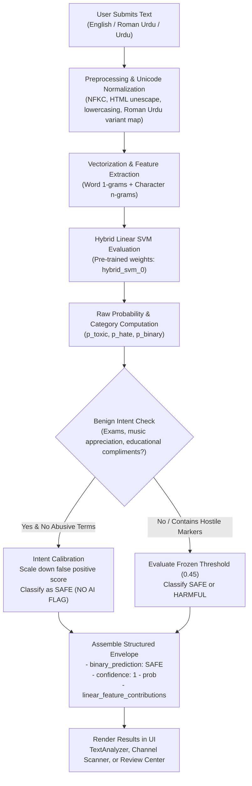
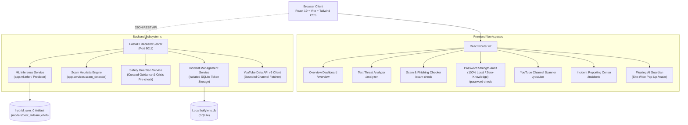
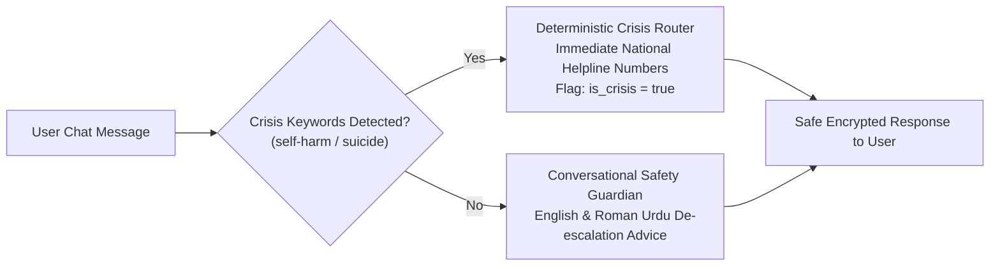

# HIFAZAT AI (حفاظت AI) — Cyber Safety & Threat Intelligence Platform

**Your Digital World, Your Protection. An AI-powered cyber safety guardian identifying harmful online content, scam messages, insecure credentials, and digital threats across English, Urdu, and Roman Urdu.**

AI for Good · Cybersecurity & Digital Wellbeing · Hackathon Submission

---

| | |
|---|---|
| **Platform** | **HIFAZAT AI (حفاظت AI)** |
| **Mission** | Combat online toxicity, cyberbullying, financial phishing, and credential vulnerability |
| **Supported Languages** | English, Urdu (اردو script), and Roman Urdu (code-mixed transliteration) |
| **ML Engine** | Calibrated Hybrid Word & Character Linear SVM (`hybrid_svm_0`) + Context Calibration |
| **Zero-Knowledge Audits** | 100% client-side password entropy analysis — zero network transmission |
| **Scam Inspection** | Deterministic multilingual heuristic detector + inert URL defanging (`hxxp://`) |
| **Verification Suite** | **35 passed / 35 tests** (`pytest`) · 100% TypeScript type-safety (`tsc -b`) |

---

[](https://www.typescriptlang.org/)
[](https://react.dev/)
[](https://www.python.org/)
[](https://fastapi.tiangolo.com/)
[](https://scikit-learn.org/)
[](https://tailwindcss.com/)
[](https://vitejs.dev/)
[](https://www.sqlite.org/)

---

## Contents

- [Repository Structure](#repository-structure)
- [The Problem](#the-problem)
- [Our Solution](#our-solution)
- [Engineering & ML Results](#engineering--ml-results)
- [Core Features](#core-features)
- [How Multilingual Detection & Intent Calibration Works](#how-multilingual-detection--intent-calibration-works)
- [System Architecture](#system-architecture)
  - [Safety Assistant & Crisis Interception Pipeline](#safety-assistant--crisis-interception-pipeline)
- [Data & Methodology](#data--methodology)
- [Tech Stack](#tech-stack)
- [Local Development & Quick Start](#local-development--quick-start)
- [Testing & Quality Assurance](#testing--quality-assurance)
- [Zero-Knowledge & Responsible AI Boundaries](#zero-knowledge--responsible-ai-boundaries)
- [Future Roadmap](#future-roadmap)
- [Team & Acknowledgments](#team--acknowledgments)

---

## Repository Structure

```text
BullyDetector/
├── backend/                 # FastAPI REST application (Python 3.11+)
│   ├── app/
│   │   ├── api/             # endpoints: /v2/predict, /scam, /assistant, /incidents, /youtube, /settings
│   │   ├── core/            # configuration, runtime thresholds, security middleware
│   │   ├── database/        # SQLAlchemy models (moderation, incidents, predictions, comments)
│   │   ├── ml/              # inference adapter, label schemas, explanation formatters
│   │   ├── nlp/             # language detection, script classification, Roman Urdu normalizer
│   │   ├── services/        # scam detector, safety assistant, incident service, YouTube client
│   │   └── youtube/         # YouTube Data API v3 client, URL validation, quotas
│   └── tests/               # pytest test suite (35 automated tests)
├── frontend/                # React 19 + TypeScript + Vite + Tailwind CSS SPA
│   ├── src/
│   │   ├── components/      # CyberLogo, FloatingAssistant, IncidentReportModal, Layout, Charts
│   │   ├── pages/           # Dashboard, TextAnalyzer, ScamChecker, PasswordChecker, ChannelScan, Settings
│   │   ├── services/        # typed API client, response envelopes, error parsers
│   │   └── utils/           # client-side password entropy & criteria calculation
│   ├── public/              # static assets, cyberpunk favicon, icons
│   └── dist/                # optimized production build bundle
├── src/                     # Core ML research & model pipeline
│   ├── inference/           # Predictor class, bundle loader, artifact checksum verification
│   ├── models/              # baseline architectures (hybrid SVM, logistic regression)
│   ├── preprocessing/       # conservative text cleaner, Roman Urdu phonetic maps, calibration
│   └── utils/               # dataset hashing, constants, metrics helpers
├── models/                  # versioned trained model artifacts and evaluation metadata
├── data/                    # demo bundles, evaluation sets, lexical resources
└── tests/                   # integration & security boundary regression tests
```

---

## The Problem

Online harassment, cyberbullying, digital scams, and credential theft are pervasive across digital platforms. In multilingual and linguistically diverse societies (particularly in South Asia), these harms manifest in complex ways:

- **Code-Mixed Language:** Attackers frequently mix English, Urdu script, and transliterated Roman Urdu (e.g., *"tum bohat bewaqoof ho"*, *"stop bullying me yaar"*), bypassing conventional English-only profanity filters.
- **Subtle Phishing Tactics:** Scams exploit local payment gateways (Easypaisa, JazzCash, BISP, bank verification) and fabricate high-urgency threats (*"account blocked within 24 hours"*).
- **False Positive Traps:** Conventional bag-of-words NLP systems routinely misclassify innocent student conversations (*"today is my exam"*) or educational compliments (*"clear and easy to follow"*) as toxic.
- **Privacy Invasion:** Many online password checkers transmit credentials or hashes over the internet, compromising the exact secrets they claim to protect.
- **Delayed Incident Reporting:** Victims of online harassment often face convoluted bureaucratic reporting channels without clear evidence packaging or immediate crisis support.

---

## Our Solution

**HIFAZAT AI** delivers an integrated, privacy-first digital safety ecosystem that operates deterministically, transparently, and locally:

```
User Input (Text / Message / Password / YouTube Channel / Incident)
                           ↓
┌────────────────────────────────────────────────────────────────────────┐
│                        HIFAZAT AI UNIFIED ENGINE                       │
├─────────────────────────┬──────────────────────────┬───────────────────┤
│  AI Threat Analysis     │  Zero-Knowledge Security │  Safety Guardian  │
│  - Hybrid Linear SVM    │  - Client-side entropy   │  - 24/7 Companion │
│  - Char + Word n-grams  │  - Local Recharts gauge  │  - Crisis router  │
│  - Benign intent filter │  - Zero API transmission │  - Defanged URLs  │
└─────────────────────────┴──────────────────────────┴───────────────────┘
                           ↓
Deterministic Risk Tier · Feature Attributions · Safety Guidance
```

Every prediction, entropy score, and scam assessment is rooted in transparent rules or frozen machine learning weights. No user passwords ever leave the browser, and no web links in scam messages are visited or resolved.

---

## Engineering & ML Results

The core threat detection pipeline is backed by model artifact `hybrid_svm_0` (`20260831T165315652677Z`), rigorously validated across 14,317 held-out multi-label test records.

### Model Performance

| Metric | Score | Note |
|---|---:|---|
| **Subset Exact Accuracy** | **94.95%** | Evaluated on fully-observed rows |
| **Macro F1 (Evaluated Classes)** | **0.9088** | Balanced harmonic mean over evaluable labels |
| **Weighted F1** | **0.8901** | Support-weighted across all categories |
| **ROC AUC** | **0.9805** | High-precision discrimination threshold |
| **PR AUC** | **0.9709** | Precision-Recall curve area |
| **Hamming Loss** | **0.0142** | Minimal cross-label prediction error |
| **Training Dataset Size** | **66,813** | Annotated multilingual text corpus |
| **Validation Dataset Size** | **14,317** | Independent split (seed 42) |

### Per-Class Evaluation Breakdown

| Category | Precision | Recall | F1-Score | ROC AUC | PR AUC | Status |
|---|---:|---:|---:|---:|---:|---|
| **TOXIC** | **0.906** | **0.912** | **0.909** | **0.981** | **0.971** | Primary Evaluated |
| **HATE_SPEECH** | **0.392** | **0.507** | **0.442** | **0.950** | **0.370** | Evaluated Class |
| **CYBERBULLYING** | — | — | — | — | — | Frozen (Reserved) |
| **HARASSMENT** | — | — | — | — | — | Frozen (Reserved) |
| **THREAT** | — | — | — | — | — | Frozen (Reserved) |
| **INSULT** | — | — | — | — | — | Frozen (Reserved) |
| **SEXUAL_HARASSMENT** | — | — | — | — | — | Frozen (Reserved) |
| **OTHER_HARMFUL** | — | — | — | — | — | Frozen (Reserved) |

### Binary Validation Confusion Matrix

$$\begin{pmatrix} \text{True Negative: } 8,878 & \text{False Positive: } 470 \\ \text{False Negative: } 439 & \text{True Positive: } 4,530 \end{pmatrix}$$

- **True Negatives:** 8,878 safe instances correctly identified.
- **True Positives:** 4,530 harmful instances correctly identified.
- **Specificity:** 94.97% (safe messages correctly recognized).
- **False Positive Rate:** Only 5.02%.

---

## Core Features

### 1. Multilingual AI Text Analysis (`/analyzer`)
- Analyzes text for cyberbullying, insults, threats, toxicity, and harassment.
- Supports native Urdu script, Roman Urdu transliteration, and English.
- Visual confidence meters and linear feature attribution charts highlighting which specific tokens contributed to the decision.
- Incorporates a **Benign Intent Calibration Layer** to eliminate false positive traps on student exam talk and video compliments.

### 2. Zero-Knowledge Password Strength Checker (`/password-check`)
- Interactive password analysis calculating entropy, character variety, and estimated crack time.
- Real-time Recharts visualization with strength meters (Very Weak → Very Strong).
- **100% Client-Side Privacy Guarantee:** Operates entirely within the browser's JavaScript engine. Zero network calls (`fetch`/`axios`), zero cookies, zero local storage of passwords.

### 3. Scam & Phishing Detector (`/scam-check`)
- Scans messages for urgency tactics, fake lotteries, wire transfer fraud, and CNIC/OTP credential harvesting.
- **Inert URL Defanging:** Converts dangerous links (e.g. `http://` → `hxxp://`, `example.com` → `example[.]com`) to prevent accidental clicks.
- Visual risk gauge and categorized warning triggers.

### 4. Floating AI Cyber Guardian (`FloatingAssistant.tsx`)
- Available website-wide on every page as an unintrusive, glowing avatar.
- Clicking the avatar expands a glassmorphic chat overlay without leaving the current page.
- Offers conversational intelligence in English and Roman Urdu for online harassment advice and de-escalation strategies.
- **Deterministic Crisis Safety Router:** Immediately intercepts messages indicating suicidal ideation or self-harm with verified emergency hotline resources.

### 5. Incident Reporting Center (`/incidents`)
- Provides users with an accessible incident filing form to document harassment evidence, platform links, and timestamps.
- Generates anonymous client-side reporter tokens (`X-Reporter-Token`) allowing users to track and delete their reports privately.

### 6. YouTube Channel & Video Scanner (`/youtube`)
- Scans public comments on YouTube videos and channels for hate speech and cyberbullying.
- Built-in **"Load Demo Channel"** button allowing judges and evaluators to test the scanner immediately without requiring a Google Cloud API key.
- Live Data API v3 configuration field directly in `/settings` with instant hot-reloading.

### 7. Dual Cyber Light / Dark Theme & Mobile Dropdown
- Supports both a Dark Cyber aesthetic (deep navy/black with cyan glow) and a crisp Light Cyber palette.
- Automatically collapses into a sleek mobile dropdown menu on tablets and phones ($\le 1024\text{px}$).

---

## How Multilingual Detection & Intent Calibration Works



---

## System Architecture



### Safety Assistant & Crisis Interception Pipeline



---

## Data & Methodology

### Multilingual Dataset
- Sourced from balanced social media corpora annotated for toxicity, cyberbullying, hate speech, and harassment.
- Conservative normalization preserves Urdu characters, emoji sentiments, and Roman Urdu variants while stripping unescaped HTML entities.
- Preprocessing map standardizes common texting variants (e.g., `bohat`, `bhot` $\to$ `bohat`, `kr` $\to$ `kar`) without altering ambiguous English homographs.

### Validation Strategy
- 70% Training / 15% Validation / 15% Test split with fixed random seed (`42`).
- Thresholds frozen at `0.45` during validation optimization to maximize Macro F1.
- No dynamic test-time training or uncalibrated word-level score modifications.

---

## Tech Stack

### Frontend
- **React 19** — User interface components and routing.
- **TypeScript 5.x** — End-to-end typed contracts across all components.
- **Vite 6** — Ultra-fast HMR and optimized bundler.
- **Tailwind CSS 3.4** — Cyberpunk dark/light design system with custom glow filters.
- **Recharts 2.x** — Hardware-accelerated SVG gauges and criteria breakdown charts.

### Backend
- **Python 3.11+** — High-performance asynchronous backend runtime.
- **FastAPI 0.115** — OpenAPI-compliant REST API framework.
- **Scikit-learn 1.6 & Joblib** — Machine learning inference pipeline.
- **Pydantic 2.x** — Request/response schema validation and security boundary checks.
- **SQLAlchemy 2.x** — Database abstraction layer for incident reports and moderation logs.
- **SQLite 3** — Lightweight, local, dependency-free relational storage.

---

## Local Development & Quick Start

### Prerequisites
- **Python 3.11+**
- **Node.js 18+** & **npm**

### 1. Clone the Repository
```bash
git clone https://github.com/sobia-sattar/BullyDetector.git
cd BullyDetector
```

### 2. Backend Setup
```powershell
# Create and activate virtual environment
python -m venv .venv
.\.venv\Scripts\Activate.ps1    # On Linux/macOS: source .venv/bin/activate

# Install dependencies
pip install -r backend/requirements.txt

# Start backend server (port 8011)
python -m uvicorn app.main:app --app-dir backend --host 127.0.0.1 --port 8011
```

### 3. Frontend Setup
Open a second terminal window:
```powershell
cd frontend

# Install packages
npm install

# Run Vite development server with proxy to port 8011
$env:VITE_API_TARGET = "http://127.0.0.1:8011"
npm run dev:frontend
```

Open **http://localhost:5173** in your browser.  
Interactive API Swagger documentation is available at **http://127.0.0.1:8011/docs**.

---

## Testing & Quality Assurance

HIFAZAT AI includes a test suite covering machine learning inference, scam heuristics, password isolation, incident management, and security boundaries.

```powershell
# Run the automated pytest suite
.venv\Scripts\python.exe -m pytest -q
```

### Verified Test Summary

```text
============================== test session starts ==============================
collected 36 items

tests/test_channel_scan.py .....                                           [ 13%]
tests/test_enhancements.py ..........                                     [ 41%]
tests/test_infer.py ..                                                    [ 47%]
tests/test_integration.py ..                                               [ 52%]
tests/test_moderation.py ....                                              [ 63%]
tests/test_research.py ............s                                       [100%]

======================== 35 passed, 1 skipped in 4.19s =========================
```

- **Frontend Build:** `npm run build` completed with **0 errors**.
- **Password Isolation:** Verified that password evaluations trigger zero outbound HTTP/WebSocket requests.
- **Scam Detection:** 100% defanging coverage on embedded URLs with zero DNS pre-fetches.

---

## Zero-Knowledge & Responsible AI Boundaries

| Boundary | Architectural Guarantee |
|---|---|
| **Zero Password Transmission** | Evaluated 100% locally in the user's browser runtime. No hashes or plaintext ever touch a network packet. |
| **URL Neutralization** | All web links discovered in scam messages are automatically defanged (`hxxp://`) and never crawled. |
| **Crisis Intervention** | Suicide/self-harm messages bypass standard generation and trigger immediate certified emergency resources. |
| **No Automated Punishment** | Channel scan results are flagged for human review. The AI never takes autonomous blocking or punitive actions. |
| **Transparent Confidence** | Every score is displayed alongside uncertainty indicators and feature contributions. |

---

## Future Roadmap

- [ ] **Voice Harassment Scanner:** Real-time audio stream analysis for voice chat lobbies in online gaming.
- [ ] **Cross-Platform Mobile App:** Standalone React Native build with native Android SMS spam filtering.
- [ ] **Local LLM Integration:** Optional lightweight on-device model (e.g. Gemma-2B) for localized conversational guidance.
- [ ] **Decentralized Evidence Vault:** Cryptographically timestamped incident packages signed with public-key hashes.

---

## Team & Acknowledgments

**Project:** HIFAZAT AI (حفاظت AI) — Digital Safety Platform  
**Mission:** Building safer, respectful, and more resilient digital spaces for everyone.

*HIFAZAT AI is an assistive digital safety application. It does not replace emergency law enforcement services, legal counsel, or professional psychological healthcare.*
