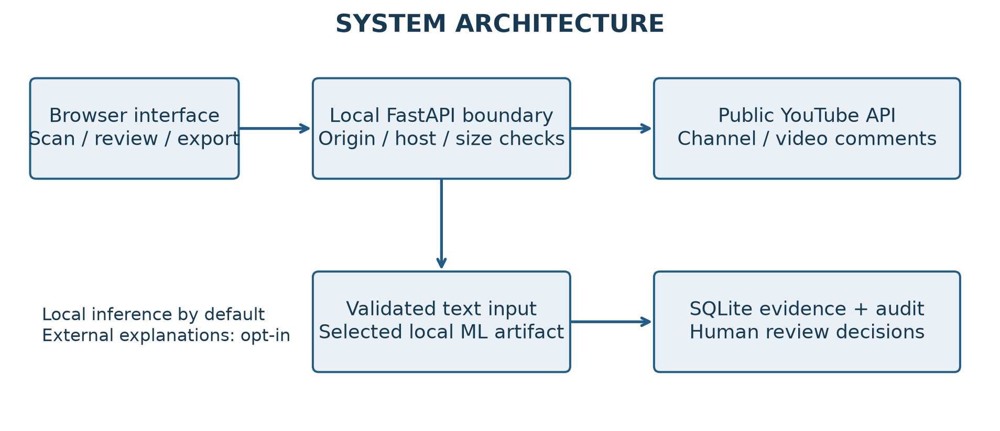
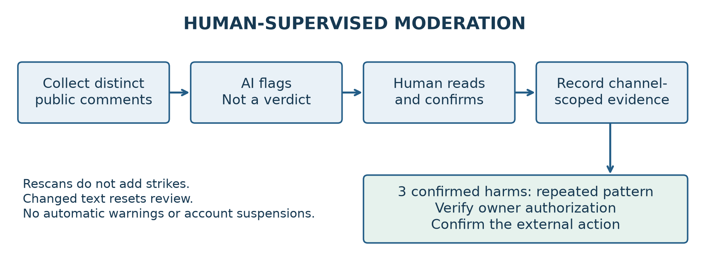
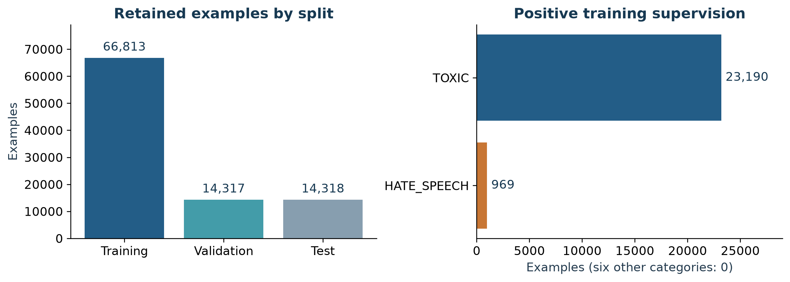
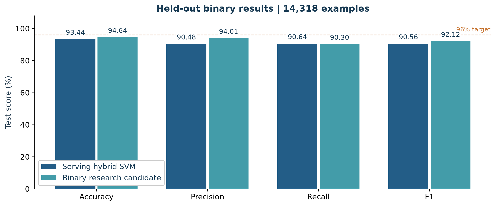
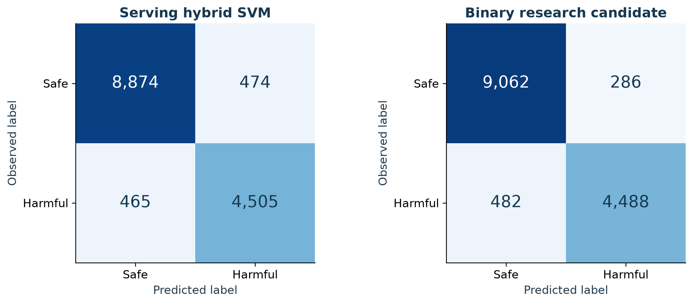
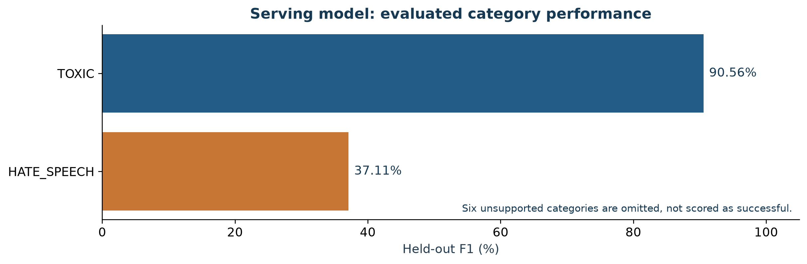

# BullyLens-X: Human-Supervised Harmful-Comment Detection for English and Roman Urdu

## Abstract

Online moderation tools must distinguish harmful language predictions from judgments about people and from authority to impose platform sanctions. This report presents BullyLens-X, a local application integrating sparse text classification, public YouTube comment collection, human review and channel-scoped moderation. Two approved source datasets yield 95,448 retained examples after cleaning, with 66,813 training, 14,317 validation and 14,318 test examples. A calibrated word-and-character support vector machine achieves 93.44% binary test accuracy and 90.56% binary F1. Its observed-category Macro-F1 is 63.84%; only HATE_SPEECH and TOXIC have positive evaluation coverage. A subsequent binary log-count-ratio challenger achieves 95.30% validation accuracy and 94.64% test accuracy, below a requested 96% target, and remains separate from the serving model. The application records distinct commenter evidence, requires human confirmation for repeated-pattern flags and verifies channel ownership before external actions. Security hardening addresses cross-site local API access, request-body limits and export injection. Findings support an inspectable prototype, not universal multilingual accuracy, automatic offender identification or unrestricted public deployment.

Keywords: harmful language; Roman Urdu; human-in-the-loop moderation; partial labels; sparse classifiers; secure local applications.

## 1. Introduction

A useful harmful-comment detector must connect classification to a reviewable decision process. An offensive phrase may occur in quotation, counterspeech, humor or a personal attack. Moreover, a harmful comment is not sufficient evidence that its writer habitually bullies others. BullyLens-X therefore separates three concepts: model predictions about text, human review of collected evidence, and authorized moderation actions.

The project studies a practical question: can a reproducible, CPU-compatible classifier support English and Roman Urdu review workflows while making its limitations visible? This work contributes an integrated prototype and an empirical evaluation of harmful-comment detection within a human-supervised moderation workflow. The system provides public channel and video scanning, single-text and CSV inference, review records, live observation, explanations and an accessible web interface. Performance targets are evaluated through controlled experiments and reported using measured results.

## 2. Related Work / Literature Review

Davidson et al. [1] distinguish hate speech from offensive language, a distinction directly relevant to avoiding inflated hate-speech claims. Their annotated source is used here with an explicit mapping rather than an assertion that its taxonomy equals cyberbullying. The Roman-Urdu-Toxic-Corpus [2] provides binary toxic labels and declares CC-BY-4.0 in its repository metadata; limited collection and annotation documentation constrains the strength of provenance claims.

Wang and Manning [3] describe strong sparse text-classification baselines involving bigrams and Naive Bayes-inspired feature representations. The project's later binary challenger uses training-derived log-count-ratio weighting followed by logistic regression. It is inspired by this general baseline family, not presented as a faithful reproduction of every setting or result in that paper.

YouTube's comment-thread API supports retrieval associated with specified videos or channels [4]. It is not a complete search interface for everything a person has written across YouTube. Channel-level moderation also depends on authorization and ownership [5]. These boundaries shape both the interface and the system's interpretation of repeated behavior.

Roman Urdu presents a specific low-resource setting. Rizwan et al. [6] introduced RUHSOLD with coarse- and fine-grained labels, showing the value of transfer learning for Roman Urdu hate and offensive-language detection. Broader abusive-language work has also shown that task definitions and sampling decisions materially affect model behavior: Waseem and Hovy [7] combined annotation criteria with character n-grams, while OffensEval formalized hierarchical distinctions among offensive content, offense type and target [8]. Research on Hindi-English code-mixed text further illustrates the difficulty of applying monolingual methods to mixed-language communication [9].

Cyberbullying benchmarks have compared classical classifiers with pretrained language models [10]. BERT [11] and XLM-R [12] provide influential contextual and multilingual representation frameworks, but their general benchmark performance does not establish performance on this project's data. They are therefore treated as relevant future comparisons rather than completed results. Surveys of hate-speech detection similarly emphasize the dependence of performance on task definition, features and dataset design [13].

Transparent reporting is essential when model outputs can influence moderation. Model cards recommend documenting intended use, evaluation conditions and limitations [14], and data statements connect corpus documentation with more precise generalization claims [15]. These principles motivate the explicit label-coverage, provenance and deployment limitations reported in this study.

## 3. System Model

The system combines data preparation, text classification, platform integration and human review within a local security boundary. The following subsections describe its components and experimental protocol.

### 3.1 Architecture and Review Workflow

The browser interface communicates with a local FastAPI service. The service obtains public comments through fixed YouTube API endpoints, validates input length, invokes the selected checksum-verified model, and stores reviewable evidence in SQLite. Trained artifacts, metadata and reports are versioned. Linear feature contributions offer model-specific evidence, not causal explanations or proof of harmful intent.

Channel scans accept channel URLs or handles and inspect up to 500 public top-level comments across at most five API pages. Replies, private content and complete global commenting histories are outside this scan. Empty comments, comments exceeding the 8,000-character model limit and text empty after preprocessing are excluded rather than truncated and mislabeled. Results disclose exclusions. A real API smoke scan retrieved 50 comments; it validates connectivity, not classification accuracy.

Evidence is grouped by commenter identifier within a channel. Repeated scans of one external comment do not create additional strikes. Changes to stored comment text reset its review. Three distinct comments confirmed harmful by a human create a repeated-pattern flag. This operational threshold is a design choice, not an empirically validated definition of habitual cyberbullying.

External warnings and rejections require explicit confirmation, human-reviewed evidence and owner OAuth configuration. Before each action, the service verifies the acting channel, video ownership, comment identity and current text. Unique action records reduce duplicate submissions. Uncertain network outcomes are marked uncertain and are not blindly retried. Channel blocking does not suspend a person's YouTube account [5]. No external moderation action was sent during the reported verification.

### 3.2 Data, Provenance and Label Coverage

The registered inputs contain 24,783 Davidson records and 72,771 Roman Urdu records. Processing retains 24,217 and 71,231 respectively, for 95,448 examples. The preparation audit records 126 conflicting exact-label rows and 881 near-duplicate removals; these are components of cleaning rather than a complete arithmetic explanation of all removals. Original source identifiers, licensing evidence, mappings and content hashes are recorded in data/dataset_registry.csv.

| Partition | Examples | Use |
|---|---:|---|
| Training | 66,813 | Feature fitting and supervised optimization |
| Validation | 14,317 | Candidate selection and threshold tuning |
| Test | 14,318 | Frozen performance reporting |
| Total | 95,448 | Retained internal corpus |

Text preparation preserves Unicode and conservative Roman Urdu normalization. Exact normalized keys are deduplicated; conflicting exact annotations are quarantined. Near-duplicate detection uses 64-permutation MinHash candidates followed by exact five-gram Jaccard comparison with a 0.85 removal threshold. Candidate retrieval is probabilistic: no exact overlap across splits does not prove the absence of semantic overlap or source artifacts. The current split is an iterative internal split, not a source-disjoint or temporal external benchmark.

Davidson hate examples map to HATE_SPEECH and TOXIC; offensive examples map to TOXIC. Roman Urdu positive labels supervise TOXIC. Unknown category annotations are represented by -1 and excluded from supervised losses and relevant metric cells. Source-benign examples are treated as negatives across categories. This last choice is a modeling assumption: source definitions of benign content need not establish absence of every fine-grained harm type.

Eight harmful category heads exist in the application schema, but training positives occur only for HATE_SPEECH (969 training positives) and TOXIC (23,190). CYBERBULLYING, HARASSMENT, THREAT, INSULT, SEXUAL_HARASSMENT and OTHER_HARMFUL have no positive training supervision. Their outputs must not be represented as validated detectors. Urdu-script spreadsheets remain excluded because use permission was not verified. Support for Urdu input encoding is not evidence of Urdu detection accuracy.

### 3.3 Classification Model and Evaluation Protocol

The original search covers five sparse families: word logistic regression, word SVM, character SVM, hybrid logistic regression and hybrid SVM, with two parameter trials per family. Four normalization or class-weight ablations are also recorded. TF-IDF features are fitted on the training split only. Hybrid representations concatenate word and character features. Independent heads mask unknown labels. Supported SVM heads use sigmoid calibration with internal cross-validation; unsupported heads are constant and disabled using thresholds above the probability range.

The selected serving model, hybrid_svm_0, uses C=0.25, balanced class weights, word unigrams, character three-to-five-grams and up to 40,000 features per branch. Category and binary thresholds are optimized on validation. The original selection objective is observed-label validation Macro-F1, not raw accuracy. The independent harmful/safe head can disagree with category thresholds; inference exposes this disagreement rather than rewriting fitted probabilities.

For known annotations, binary accuracy is (TP + TN) / N and F1 is 2TP / (2TP + FP + FN). Category Macro-F1 averages only labels with observed positive and negative coverage. Consequently, the reported Macro-F1 is not an eight-category result and is not comparable to historical nine-label scores in the repository.

### 3.4 Controlled Training Experiments

A first challenger expands the hybrid calibrated SVM to word bigrams and 60,000 features per branch at C=4. It reaches 94.15% binary validation accuracy, but category Macro-F1 drops from 67.55% to 66.09%. The predeclared promotion rule requires improved category Macro-F1 with no lower binary F1, so the candidate is not promoted.

A second experiment targets binary accuracy using 100,000 TF-IDF features per branch, word bigrams, training-only log-count-ratio weighting and logistic regression with C=1. For feature j, the weight is the logarithm of the ratio between smoothed, normalized positive-class and negative-class feature totals. Validation thresholds are searched from 0.10 to 0.90 in 0.01 increments. Eligibility requires validation recall and F1 at least as high as the serving binary head. The selected threshold is 0.34.

This candidate reaches 95.30% validation accuracy. Although below the requested 96% target, validation improvement motivates one fixed-threshold test evaluation. That decision is documented after validation, rather than portrayed as part of the original target-triggered test protocol. Test labels are not used for fitting or threshold selection. Nevertheless, these are sequential experiments on an established benchmark whose earlier results were already visible; an untouched external corpus is necessary for a stronger confirmatory claim. The binary candidate remains a research artifact and is not silently installed into the multi-category interface.

### 3.5 Security and Privacy Model

Assets include comment text, channel and commenter identifiers, review decisions, API credentials, model artifacts and audit records. Threats considered include cross-site requests to a loopback service, hostile Host headers, oversized uploads, exported spreadsheet formulas, malicious PDF markup, stale moderation evidence and duplicate external actions. Local compromise and a malicious authorized workstation user remain outside the protection provided by request-origin checks.

The hardening pass adds a shared local boundary to API routes: loopback peer restrictions, an allowlist of local hosts and origins, cross-site request rejection, and a 2.1 MB transport-body limit. The body limit is checked while reading, rather than trusting only Content-Length. Responses use no-store, nosniff, frame-denial and no-referrer headers. Regression tests verify valid JSON replay, cross-site rejection, hostile hosts, invalid length headers and actual oversized bodies.

CSV export prefixes formula-like comment strings so spreadsheet tools do not interpret attacker-controlled text as formulas. PDF export escapes untrusted text before ReportLab parsing, preventing comments from becoming document markup or image resource references. Tests cover both paths. Stored and displayed model probabilities are not rewritten to match a requested performance figure.

External GenAI explanation requests are disabled by default and now require ALLOW_EXTERNAL_EXPLANATIONS=true in addition to credentials. This opt-in acknowledges that comment excerpts may leave the workstation. The generative layer has no moderation tool authority and does not modify classification metrics; untrusted comments are described as data rather than instructions. This reduces exposure but does not establish complete prompt-injection resistance.

The application is not ready for unrestricted public hosting. Important deployment work includes authenticated multi-user sessions, role-based authorization, a managed OAuth refresh-token vault, HTTPS, rate/concurrency controls, retention and deletion policy, encrypted backups, dependency vulnerability monitoring and independent penetration testing. An unencrypted local database and bearer tokens configured on the workstation require operating-system access controls. Local-origin checks are not a substitute for authentication.

### 3.6 Reproducibility and Artifact Availability

The active artifact is recorded in artifacts/selected.json; final metrics and frozen predictions are retained under reports and reports/metrics. The expanded hybrid-SVM experiment and the log-count-ratio logistic-regression experiment are documented in reports/training_audit.json and reports/accuracy_target_experiment.json, respectively. Exact model paths and threshold provenance are included in those records.

Run the regression suite with .venv/Scripts/python.exe -m pytest -q and compile the interface with npm run build in frontend. The standard pipeline can regenerate reports with --skip-prepare --reuse-trained. The scripts audit_retrain.py and accuracy_candidate.py describe the follow-up experiments; running training creates new artifacts and may use substantial CPU time. The former has an explicit validation-based promotion condition, so reproducing it should occur in a separate copy if the serving selection must remain frozen. Credentials and collected personal comment records are not required parts of a public research release.

## 4. Results and Discussion

Figure 4 illustrates the held-out binary performance of the serving hybrid SVM and the binary research candidate. It compares accuracy, precision, recall and F1 across the same 14,318 test examples and marks the requested 96% accuracy target as a reference rather than an achieved result.

Figure 5 presents the confusion matrices for both models. It shows the distribution of true-safe, false-positive, false-negative and true-harmful predictions, allowing the reduction in false positives and the accompanying change in false negatives to be assessed directly.

Figure 6 reports category-level F1 for the two serving-model category heads with positive and negative test coverage. HATE_SPEECH and TOXIC are shown separately, while the six unsupported category heads are excluded rather than assigned misleading performance scores.

Table 1. Validation and held-out test performance of the serving hybrid SVM and the binary research candidate.

| Measure | Serving hybrid SVM | Binary research candidate |
|---|---:|---:|
| Validation binary accuracy | 93.65% | 95.30% |
| Held-out test accuracy | 93.44% | 94.64% |
| Held-out binary precision | 90.48% | 94.01% |
| Held-out binary recall | 90.64% | 90.30% |
| Held-out binary F1 | 90.56% | 92.12% |
| Observed-category test Macro-F1 | 63.84% | Not evaluated as a category model |

The serving model's test confusion matrix contains TN=8,874, FP=474, FN=465 and TP=4,505. The candidate has TN=9,062, FP=286, FN=482 and TP=4,488. Thus the candidate reduces false positives by 188 but increases false negatives by 17 on this split. Its approximately 1.19 percentage-point accuracy improvement must be interpreted alongside that trade-off, not as dominance in every metric. No paired significance test or independent replication is claimed.

For the serving category heads, HATE_SPEECH has 208 positive test examples and F1=37.11%; TOXIC has 4,970 positives and F1=90.56%. The stored 200-resample row-bootstrap interval for observed-category Macro-F1 is approximately [0.6129, 0.6613]. This interval is conditional on the fitted model and split; it does not cover all uncertainty from model selection, annotation, source bias or deployment shift.

The software regression suite verifies model probability and threshold behavior, CSV inference, YouTube input handling, repeated-evidence rules, action preconditions and security boundaries. Production frontend compilation is checked separately. Passing these tests establishes behavior under tested cases; it does not certify model fairness, successful public deployment or complete security. Visual browser inspection was unavailable because of an environment browser restriction.

### 4.2 Limitations and Ethical Discussion

The most important limitation is annotation coverage. Six category names in the schema lack positive supervision, and native Urdu performance is not established. Language groups are heuristic labels rather than audited truth. Roman Urdu spelling, dialect, sarcasm and conversational context may shift the decision distribution. A detector trained on source text collections is not necessarily calibrated on a creator's live YouTube community.

Repeated-pattern flags are limited to collected, human-reviewed comments. Identity matching through platform identifiers cannot establish a person's character, intent or behavior elsewhere. False positives can suppress legitimate criticism or counterspeech; false negatives can leave targets exposed. Reviewers should examine context, record decisions and avoid treating scores as proof. Automated bans or claims that all harmful users have been identified are unsupported.

The 96% and 100% targets were not achieved on held-out test data. Neither rounding nor substituting validation accuracy for test accuracy would repair that gap. Future improvements require independently annotated, licensed data covering missing categories and Urdu script, clearer annotation guidelines, inter-annotator agreement analysis and external evaluation. Pretrained transformer training is implemented as an option but was not completed in these reported experiments; a tiny optimization smoke test is not a trained transformer benchmark.

## 5. Conclusion

BullyLens-X demonstrates an inspectable local workflow linking harmful-language classification to human review and constrained platform actions. The serving model achieves 93.44% binary test accuracy; a separate sparse binary challenger achieves 94.64%. The more important engineering result is a clear separation between classification, evidence, reviewer decisions and platform authority. Missing label coverage, uncertain domain transfer and deployment security requirements remain material. The project should be presented as a tested research prototype with documented limitations, not as a universal or fully autonomous cyberbullying prevention system.

## References

[1] T. Davidson, D. Warmsley, M. Macy and I. Weber. Automated Hate Speech Detection and the Problem of Offensive Language. ICWSM, 2017. https://arxiv.org/abs/1703.04009

[2] hafiz-hassaan-saeed. Roman-Urdu-Toxic-Corpus. Hugging Face dataset repository; CC-BY-4.0 declared in metadata. Accessed 31 August 2026. https://huggingface.co/datasets/hafiz-hassaan-saeed/Roman-Urdu-Toxic-Corpus

[3] S. Wang and C. D. Manning. Baselines and Bigrams: Simple, Good Sentiment and Topic Classification. ACL, 2012, pp. 90–94. https://aclanthology.org/P12-2018/

[4] Google. YouTube Data API v3: CommentThreads.list. Accessed 31 August 2026. https://developers.google.com/youtube/v3/docs/commentThreads/list

[5] Google. YouTube Data API v3: Comments.setModerationStatus. Accessed 31 August 2026. https://developers.google.com/youtube/v3/docs/comments/setModerationStatus

[6] H. Rizwan, M. H. Shakeel and A. Karim. Hate-Speech and Offensive Language Detection in Roman Urdu. EMNLP, 2020, pp. 2512–2522. https://aclanthology.org/2020.emnlp-main.197/

[7] Z. Waseem and D. Hovy. Hateful Symbols or Hateful People? Predictive Features for Hate Speech Detection on Twitter. NAACL Student Research Workshop, 2016, pp. 88–93. https://aclanthology.org/N16-2013/

[8] M. Zampieri, S. Malmasi, P. Nakov, S. Rosenthal, N. Farra and R. Kumar. SemEval-2019 Task 6: Identifying and Categorizing Offensive Language in Social Media (OffensEval). SemEval, 2019, pp. 75–86. https://aclanthology.org/S19-2010/

[9] P. Rani, S. Suryawanshi, K. Goswami, B. R. Chakravarthi, T. Fransen and J. P. McCrae. A Comparative Study of Different State-of-the-Art Hate Speech Detection Methods in Hindi-English Code-Mixed Data. TRAC, 2020. https://aclanthology.org/2020.trac-1.7/

[10] S. Salawu, Y. He and J. Lumsden. Benchmarking Language Models for Cyberbullying Identification and Classification from Social-media Texts. LaTeCH-CLfL, 2022. https://aclanthology.org/2022.lateraisse-1.4/

[11] J. Devlin, M.-W. Chang, K. Lee and K. Toutanova. BERT: Pre-training of Deep Bidirectional Transformers for Language Understanding. NAACL-HLT, 2019, pp. 4171–4186. https://aclanthology.org/N19-1423/

[12] A. Conneau et al. Unsupervised Cross-lingual Representation Learning at Scale. ACL, 2020, pp. 8440–8451. https://aclanthology.org/2020.acl-main.747/

[13] A. Schmidt and M. Wiegand. A Survey on Hate Speech Detection using Natural Language Processing. SocialNLP, 2017, pp. 1–10. https://aclanthology.org/W17-1101/

[14] M. Mitchell et al. Model Cards for Model Reporting. FAT*, 2019, pp. 220–229. https://arxiv.org/abs/1810.03993

[15] E. M. Bender and B. Friedman. Data Statements for Natural Language Processing: Toward Mitigating System Bias and Enabling Better Science. Transactions of the Association for Computational Linguistics, 6, 2018, pp. 587–604. https://aclanthology.org/Q18-1041/
